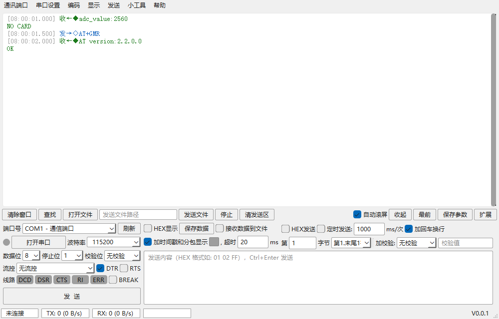
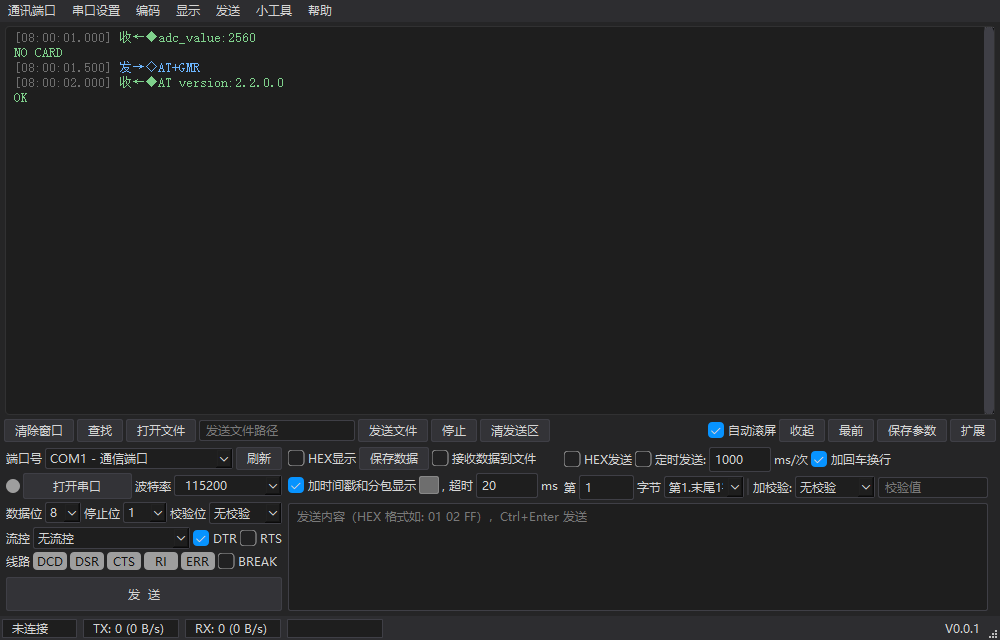

# PyCom 串口/网络数据调试器

轻量的串口 / TCP / UDP 调试工具，使用 Python + PySide6（Qt6）从零实现，功能布局参考 SSCOM 5.13.1。绿色便携、无广告、开源（MIT）。





## 功能特性

- **通讯通道**：串口；TCP 客户端 / TCP 服务端 / UDP（三模式共用一套收发体验，网卡选择联动本地 IP，断线自动重连）
- **接收显示**：HEX / ASCII 切换、12 种预置编码 + 任意 Python 编码名、时间戳与分包显示（包首行 `[时:分:秒.毫秒]收←◆ / 发→◇`）、收发着色、多字体设置、搜索高亮（绝对行号定位）、显示缓冲上限 200K~512M（默认 128MB，溢出自动丢最旧）、接收转存 txt、保存原始字节
- **发送**：文本/HEX、加回车换行、定时发送、多条字符串发送（ASC/HEX、顺序号、逐条延时、循环发送、单击发送）、发送文件（256 字节分块、延时档位、进度与停止）、7 种校验算法（ModbusCRC16/CCITT_CRC16/CRC8/XOR8/ADD8/ADD16/无）与 SSCOM 同语义的帧尾档位
- **终端仿真**：光标放进接收区即可输入——回车发送整行（自带回显），或按键立即发送键值；两种方式互斥
- **界面**：浅色 / 深色主题（标题栏跟随）、窗口可缩到只剩配置列（窄窗自适应）、状态栏收发速率统计、线路信号（DCD/DSR/CTS/RI/ERR/BREAK）
- **小工具**：转换计算器（DEC/HEX/BIN/ASCII/float 大小端）、ASCII 码表、设备管理器入口

## 下载与运行

到 [Releases](../../releases) 下载，或用仓库内构建脚本自行打包：

| 产物 | 说明 |
|---|---|
| `PyCom.exe`（单文件版，约 24MB） | 拷到任意位置直接运行，启动需先解包、稍慢 |
| `PyCom/`（目录版） | `PyCom.exe` 需与 `_internal/` 文件夹一起拷贝，启动快 |

运行要求：Windows 10 及以上（x64），无需安装 Python 或其他运行库。

配置文件 `pycom.json`、接收日志、导出文件均生成在 exe 同目录。

## 从源码运行

```bash
pip install PySide6
python main.py
```

依赖只有一个：`PySide6`（Qt6 官方 Python 绑定，串口走 QtSerialPort，不需要 pyserial）。

## 打包

```bat
tools\build_exe.bat
```

需要 Python 3.13 + `pip install pyinstaller`。脚本按 `PyCom.spec` 一次产出目录版与单文件版；spec 内置体积裁剪（剔除未使用的 Qt QML/Quick/Pdf/OpenGL 软件回退/虚拟键盘/翻译等组件，共约减 60%）。

## 开发与测试

```bash
pip install pytest
python -m pytest tests/ -q        # 89 项单元/界面回归测试
```

测试覆盖校验算法、分包与持续流、行表裁剪、编码切分、终端仿真、发送队列、网络广播、配置防护、主题与状态栏等核心路径。

## 目录结构

```
├─ main.py            入口（主题/图标/配置装载）
├─ app/
│  ├─ core/           纯逻辑与连接层（可单测）：环形缓冲、行格式化、
│  │                  校验、HEX、串口/网络链路、多条发送、发送文件、终端、配置
│  ├─ ui/             界面层：主窗口、自绘接收视图、查找条、计算器、主题
│  └─ version.py      版本号（单一来源）
├─ assets/            图标资源（svg 运行期渲染 + ico 打包图标）
├─ tests/             pytest 回归测试
├─ tools/             打包脚本、图标生成
└─ PyCom.spec         PyInstaller 打包配置（含体积裁剪清单）
```

架构约定：逻辑与界面分层，`app/core/` 不依赖 Qt 界面；所有连接类走主线程信号槽，不开线程；接收路径为「原始字节 → 环形缓冲 → 增量行格式化 → 只绘制可视区（30fps 合并刷新）」，128MB 缓冲不卡界面。

## 许可证

[MIT License](LICENSE) · Copyright © 2026 CoderNotCutie
